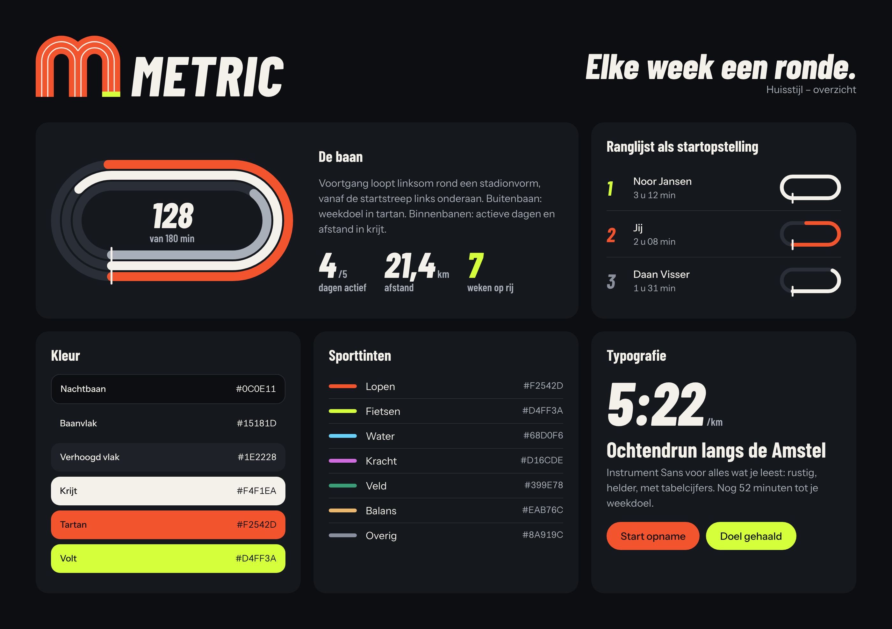

# Metric – huisstijl

**Elke week een ronde.**

Metric is een sport-app: je neemt op, je ziet je week, je deelt met vrienden. De huisstijl haalt alles uit één plek
waar sport gemeten wordt: **de atletiekbaan**. Voortgang is een baan die volloopt, een ranglijst is een startopstelling,
een behaald doel is een finishstreep.



De machineleesbare versie van alles hieronder staat in [`tokens.json`](tokens.json).
De huisstijl is opgezet in ElevenLabs: brand kit **Metric** (id `c6rbkn6YuOaJvU4fdLng`), met de beelden en geluiden
in de flow [Metric – huisstijl](https://elevenlabs.io/app/flows/I8OYCwvPBgKqclNJxx44).

## Het idee in drie regels

1. **De baan in plaats van de ring.** Voortgang loopt rond een stadionvorm (rechthoek met volledig ronde uiteinden),
   in banen naast elkaar. Geen cirkelringen.
2. **Altijd donker, twee accenten.** Bijna-zwarte Nachtbaan, krijtwitte tekst, tartanrood voor wat van jou is en volt
   voor het moment dat telt (finish, doel, record).
3. **Het cijfer is de held.** Eén groot cursief cijfer per kaart, de eenheid klein ernaast, en het cijfer telt op
   terwijl de baan volloopt.

## Logo

Het beeldmerk is een kleine **m** waarvan de twee bogen de bochten van een baan zijn: drie banen met krijtwitte
baanlijnen, en een finishstreep aan de voet van de laatste poot. Het woordmerk is METRIC in Barlow Condensed
ExtraBold cursief (in de SVG's omgezet naar contouren, dus zonder lettertype te gebruiken).

| Bestand | Gebruik |
| --- | --- |
| `logo/metric-mark-dark.svg` | Beeldmerk op donker (standaard): volt finishstreep |
| `logo/metric-mark-light.svg` | Beeldmerk op licht: finishstreep in inkt, want volt valt weg op krijt |
| `logo/metric-mark-small-dark.svg`, `…-small-light.svg` | Onder 32 px hoogte: zonder baanlijnen |
| `logo/metric-mark-mono.svg` | Eén kleur (`currentColor`), voor stempels en éénkleurendruk |
| `logo/metric-wordmark-dark.svg`, `…-light.svg` | Woordmerk in krijt of inkt |
| `logo/metric-lockup-dark.svg`, `…-light.svg` | Vaste opstelling van beeldmerk en woordmerk |
| `icon/app-icon-1024.png` | App-icoon voor iOS: krijtwit beeldmerk op een vol tartan vlak (RGB, zonder alpha) |
| `icon/app-icon-watch-1024.png` | Zelfde tekening, kleiner gezet zodat hij binnen het ronde masker blijft |
| `icon/app-icon.svg`, `icon/app-icon-watch.svg` | De bronnen van de iconen |

Regels:

- Vrije ruimte rondom: één pootdikte (drie banen).
- Niet kantelen, uitrekken, van kleur wisselen of in een cirkel zetten. De finishstreep blijft aan de laatste poot.
- Geen schaduw, gloed of verloop.

Het beeldmerk is met de hand in SVG getekend; `logo-verkenning` in `images/` is de ElevenLabs-verkenning die als
voorbeeld diende.

## Kleur

Metric is **altijd donker**: de apps en de website hebben geen lichte modus. De lichte waarden zijn er alleen voor
drukwerk, e-mail en plekken waar donker niet kan.

### Donker (standaard)

Contrast is gemeten tegen de drie ondergronden: Nachtbaan / Baanvlak / Verhoogd vlak.

| Naam | Hex | Rol | Contrast |
| --- | --- | --- | --- |
| Nachtbaan | `#0C0E11` | Achtergrond van elk scherm | – |
| Baanvlak | `#15181D` | Kaarten en panelen | – |
| Verhoogd vlak | `#1E2228` | Invoervelden, hover, menu's | – |
| Baanlijn | `#2A2F37` | Scheidingen, lege baan | – |
| Baanlijn sterk | `#3A404A` | Randen van bediening | – |
| Krijt | `#F4F1EA` | Tekst en cijfers | 17,1 / 15,8 / 14,2 |
| Krijt gedempt | `#A9AFB8` | Secundaire tekst | 8,8 / 8,1 / 7,2 |
| Stil | `#8A919C` | Bijschriften, eenheden | 6,1 / 5,6 / 5,0 |
| Tartan | `#F2542D` | Voortgang, primaire knop, jouw gegevens | 5,6 / 5,2 / 4,6 |
| Tartan licht | `#FF6A3D` | Hover en ingedrukt | 6,8 / 6,3 / 5,6 |
| Volt | `#D4FF3A` | Finish, doel gehaald, record, live | 16,7 / 15,4 / 13,8 |

Alle tekstkleuren halen WCAG AA (4,5 : 1) op alle drie de ondergronden.

**Tekst op tartan of volt is altijd inkt (`#0C0E11`)**: 5,6 : 1 op tartan en 16,7 : 1 op volt. Krijtwit op tartan
haalt maar 3,1 : 1 en is dus niet toegestaan voor tekst.

### Licht (drukwerk en lichte insluitingen)

Contrast tegen Krijt / Wit / Krijt donker.

| Naam | Hex | Rol | Contrast |
| --- | --- | --- | --- |
| Krijt | `#F4F1EA` | Achtergrond | – |
| Wit | `#FFFFFF` | Kaarten | – |
| Krijt donker | `#E9E5DC` | Verhoogd vlak | – |
| Inkt | `#0C0E11` | Tekst | 17,1 / 19,3 / 15,4 |
| Inkt gedempt | `#4A515B` | Secundaire tekst | 7,1 / 8,0 / 6,4 |
| Stil | `#5B636E` | Bijschriften | 5,4 / 6,1 / 4,8 |
| Tartan-inkt | `#C2390F` | Tartan als tekst of dunne lijn | 4,8 / 5,4 / 4,3 |
| Volt-inkt | `#4F6B00` | Volt als tekst | 5,4 / 6,1 / 4,9 |

Tartan-inkt haalt AA op Krijt en Wit, niet op Krijt donker; zet het daar niet als kleine tekst. Tartan zelf
(`#F2542D`) is op licht alleen een vlak- of knopkleur met inkt-tekst. Volt staat op licht alleen op een inktvlak.

### Sporttinten

Eén vaste tint per sportfamilie. De tint volgt de sport, nooit de rangorde.

| Familie | Hex | Sporten |
| --- | --- | --- |
| Lopen | `#F2542D` | hardlopen, wandelen, hiken |
| Fietsen | `#D4FF3A` | fietsen |
| Water | `#68D0F6` | zwemmen, roeien |
| Kracht | `#D16CDE` | krachttraining, HIIT |
| Veld | `#399E78` | voetbal, tennis |
| Balans | `#EAB76C` | yoga |
| Overig | `#8A919C` | overig (neutraal) |

Gecontroleerd met `validate_palette.js` (donker, tegen Nachtbaan én Baanvlak, **alle paren**, zonder de neutrale
Overig):

- Kleurenblind-scheiding: slechtste paar ΔE 11,5 (Veld ↔ Lopen, deutan) – geslaagd (norm ≥ 8).
- Normaal zicht: slechtste paar ΔE 20,2 (Balans ↔ Fietsen) – geslaagd (norm ≥ 15).
- Contrast tegen de ondergrond: alle zes ≥ 3 : 1 – geslaagd. Chroma – geslaagd.
- **Helderheidsband: niet geslaagd.** Volt, Water, Balans en Kracht zijn lichter dan de band die de validator voor
  grote grafiekvlakken op donker aanhoudt. Dat is een bewuste keuze voor felle sportkleuren, met deze regels als
  gevolg:
  - Sporttinten staan alleen in **dunne markeringen**: banen, lijnen, iconen, een streepje naast een naam. Nooit als
    groot vlak en nooit als achtergrond van tekst (behalve tartan en volt met inkt-tekst).
  - Een sporttint staat **altijd samen met het sporticoon en de naam**; kleur alleen draagt nooit de betekenis.
  - Sporttinten staan **altijd op een donker vlak**, ook in een lichte omgeving (dan op een inktkleurig plaatje).
    Er is daarom geen aparte lichte reeks.

### Status

Alleen voor toestand, altijd met icoon en tekst, nooit als sporttint: fout `#FF5C7A`, let op `#FFC247`,
gelukt `#5BE08A`.

## Typografie

| Rol | Lettertype | Gewichten | Voor |
| --- | --- | --- | --- |
| Display | **Barlow Condensed** | 600, 700, 700 cursief, 800 cursief | Cijfers, koppen, baannummers, woordmerk |
| Tekst | **Instrument Sans** | 400, 500, 600 | Lopende tekst, knoppen, formulieren, lijsten |

Beide vallen onder de SIL Open Font License 1.1. De gebruikte `.ttf`-bestanden staan met hun licentietekst in
[`fonts/`](fonts), zodat iOS ze direct kan bundelen.

- Web: `@fontsource/barlow-condensed` en `@fontsource/instrument-sans` (of de `.ttf`'s uit `fonts/` via `next/font/local`).
- iOS en watchOS: de `.ttf`'s uit `fonts/` (dezelfde bestanden als in `@expo-google-fonts/barlow-condensed` en
  `@expo-google-fonts/instrument-sans`). PostScript-namen: `BarlowCondensed-SemiBold`, `BarlowCondensed-Bold`,
  `BarlowCondensed-BoldItalic`, `BarlowCondensed-ExtraBoldItalic`, `InstrumentSans-Regular`, `InstrumentSans-Medium`,
  `InstrumentSans-SemiBold`.
- Beide lettertypen hebben tabelcijfers (`tnum`). Zet die altijd aan (`font-variant-numeric: tabular-nums`,
  in SwiftUI `.monospacedDigit()`), anders verspringen optellende cijfers.

Schaal (px op web, pt op iOS):

| Stijl | Lettertype | Grootte / regel |
| --- | --- | --- |
| Heldencijfer | Barlow Condensed 800 cursief | 96 / 0,9 |
| Groot cijfer | Barlow Condensed 800 cursief | 56 / 0,95 |
| Cijfer | Barlow Condensed 700 cursief | 32 / 1,0 |
| Titel | Barlow Condensed 700 | 34 / 1,05 |
| Kop | Barlow Condensed 700 | 24 / 1,1 |
| Label bij cijfer | Barlow Condensed 600 | 17 / 1,2 |
| Tekst | Instrument Sans 400 (nadruk 500) | 16 / 1,5 |
| Klein | Instrument Sans 400 | 14 / 1,45 |

Regels: twee of drie groottes per scherm; labels in gewone zinsvorm; geen lopende tekst in Barlow Condensed; geen
derde lettertype en geen monospace.

## Vormtaal: de baan

- **Stadionvorm.** Een rechthoek met volledig ronde uiteinden, standaard twee keer zo breed als hoog. Knoppen, chips
  en voortgangsbalken hebben dezelfde volledig ronde uiteinden; kaarten hebben straal 20.
- **Linksom.** De baan loopt vol zoals er op een echte baan gelopen wordt: start en finish liggen links op het rechte
  stuk onderaan, de voortgang loopt daar naar rechts, de bocht door, bovenlangs terug en via de linkerbocht naar de
  finish.
- **Banen.** Hooguit drie banen naast elkaar, 3 px tussenruimte. De buitenbaan is het hoofddoel in tartan; binnenbanen
  zijn krijt en krijt gedempt (of sporttinten als de banen sporten voorstellen). Lege baan: Baanlijn `#2A2F37`.
- **Finishstreep.** Een korte dwarsstreep op het startpunt, krijtwit, die volt kleurt zodra het doel is gehaald.
  Boven 100% loopt een tweede ronde in volt over de eerste; het cijfer blijft de waarheid.
- **Baannummers.** Grote cursieve cijfers voor rangorde: plaats in de ranglijst, dag van de week, positie.
- **Baanlijnen.** Dunne parallelle lijnen als scheiding en ritme.
- **Egale vlakken.** Eén toonstap tussen achtergrond, kaart en verhoogd vlak. Geen verlopen, gloed, glas of schaduw
  op rustende elementen; geen emoji; geen iconen in gekleurde rondjes.

Voorbeelden als SVG: [`motif/baan-voorbeeld.svg`](motif/baan-voorbeeld.svg) en
[`motif/baan-doel-gehaald.svg`](motif/baan-doel-gehaald.svg). Eén baan is dit pad (breedte `w`, hoogte `h`,
`d` = afstand van de buitenrand tot het midden van de baan, `r = h/2 − d`):

```
M h/2 (h−d)  H (w−h/2)  A r r 0 0 0 (w−h/2) d  H h/2  A r r 0 0 0 h/2 (h−d)  Z
```

Geef het pad `pathLength="100"` en vul met `stroke-dasharray="<procent> 100"` en ronde lijnuiteinden.

## Beweging

Beweging laat zien dat er iets is veranderd in je gegevens; anders beweegt er niets.

| Naam | Duur | Verloop | Wat |
| --- | --- | --- | --- |
| Druk | 120 ms | sprint | Knoppen en kaarten krimpen naar 0,97 bij indrukken |
| Snel | 200 ms | sprint | Kleurwissels, finishstreep wordt volt |
| Basis | 320 ms | sprint | Kaarten en lijstregels komen 12 px omhoog met een fade, 60 ms na elkaar, hooguit zes |
| Traag | 520 ms | sprint | Sheets, samenvatting na een opname |
| Teller | 800 ms | sprint | Cijfers tellen op naar de nieuwe waarde |
| Ronde | 900 ms | sprint | De baan loopt vol; banen starten 80 ms na elkaar |

Verloop (CSS):

- **sprint** `cubic-bezier(0.16, 1, 0.3, 1)` – snelle start, rustige uitloop; voor binnenkomen, baan en teller.
- **stride** `cubic-bezier(0.65, 0, 0.35, 1)` – van toestand wisselen, tabbladen.
- **exit** `cubic-bezier(0.4, 0, 1, 1)` – verdwijnen.
- **kick** `cubic-bezier(0.34, 1.56, 0.64, 1)` – doorveren bij kudos en een behaald doel.

Veren (SwiftUI): **kick** `response 0.32, dampingFraction 0.55`; **settle** `response 0.45, dampingFraction 0.85`.

Vaste momenten:

- **Ronde en teller** starten samen: de baan loopt vol terwijl het cijfer optelt.
- **Kudos**: het icoon veert 1 → 1,25 → 1, kleurt tartan en het aantal telt één op; op iOS een lichte haptische tik.
- **Startschot**: 3, 2, 1 als grote baannummers, dan de startpiep.
- **Finish**: de samenvatting schuift in, de cijfers tellen op, de baan loopt vol; bij een record één volt-flits.
- **Live**: tijdens een opname knippert alleen de volt live-stip.

**Verminder beweging**: geen verplaatsing, schaal of doorveren. Baan en cijfers tonen direct de eindwaarde,
overgangen worden een fade van 120 ms en de live-stip staat stil. Haptiek en geluid blijven.

## Geluid

Drie korte geluiden, gegenereerd met ElevenLabs Sound Effects en daarna ingekort. Elk geluid staat er als `.caf`
(PCM 16-bit, mono, 44,1 kHz, voor iOS en watchOS) en als `.mp3` (128 kbit/s, mono, voor het web).

| Moment | Omschrijving | Bestanden | Duur | Piek |
| --- | --- | --- | --- | --- |
| Start opname | Droge, stijgende startpiep | `sounds/start.caf`, `sounds/start.mp3` | 1,0 s | −4,0 dB |
| Opname klaar | Heldere chime met een zachte lage tik | `sounds/finish.caf`, `sounds/finish.mp3` | 0,7 s | −6,5 dB |
| Kudos | Korte, veerkrachtige pop | `sounds/kudos.caf`, `sounds/kudos.mp3` | 0,3 s | −3,7 dB |

Bewerking ten opzichte van de originelen in `sounds/origineel/`:

- **Start** was 2,04 s, een toon die steeds luider wordt. Hij is twee keer zo snel afgespeeld met behoud van
  toonhoogte en afgekapt op 1,0 s met een fade-out van 0,1 s.
- **Finish** was 1,04 s, waarvan na 0,6 s alleen nog stilte. Afgekapt op 0,7 s met een fade-out van 0,15 s.
- **Kudos** was 2,04 s, waarvan 1,8 s stilte. Afgekapt op 0,3 s met een fade-out van 0,1 s.

De geluiden zijn **niet beluisterd**, alleen gemeten (duur, formaat, luidheidsverloop). Luister ze na voordat ze in
de apps komen; vooral de versnelde startpiep kan anders klinken dan bedoeld. Geluid is nooit de enige terugkoppeling:
er is altijd ook beeld en, op iOS, een haptische tik.

## Beeldtaal

Fotografeer de baan zelf: tartan, krijtlijnen, baannummers, startblokken, schijnwerperlicht. Hard, gericht licht en
lange schaduwen, bij nacht of schemer. Mensen klein, van boven of van achteren, in beweging, zonder herkenbaar gezicht.
Volt alleen als klein detail (schoenen, veter). Geen stockfoto's van lachende sporters, geen merklogo's, geen pastel.

| Beeld | Voor | Bestanden |
| --- | --- | --- |
| Baanbocht bij nacht | Startpagina; donkere ruimte rechts voor een kop | `images/baan-bocht-nacht.jpg` |
| Startlijn bij schemer | Lege toestanden ("nog niets opgenomen") | `images/startlijn-schemer.jpg` |
| Tartan van dichtbij | Achtergrond en accenten | `images/tartan-textuur.jpg` |

Per beeld staat er een webversie (JPEG, 1280 × 720, 145 tot 289 kB) en een voorbeeld van 512 px
(`…-preview.jpg`); de PNG-originelen staan alleen in de ElevenLabs brand kit. De beelden zijn 1280 px breed;
op een groot scherm schermvullend gebruikt worden ze zichtbaar zacht, dus zet er dan een donkere laag overheen of
houd ze kleiner.

## Tone of voice

Nederlands, je-vorm. Direct en aanmoedigend, als een trainingsmaat die naast je loopt.

- Kort en concreet; begin met het cijfer of het werkwoord: "Nog 42 minuten tot je weekdoel."
- Benoem wat er is gedaan, niet hoe goed iemand is: "Derde week op rij."
- Sporttaal waar die past: ronde, baan, startschot, finish, eindsprint.
- Een lege toestand geeft de eerste stap: "Nog niets opgenomen. Start je eerste ronde."
- Een foutmelding zegt wat er misging en wat je kunt doen.
- Geen uitroeptekens-overdaad (hooguit één bij een echt record), geen schuldgevoel of druk, geen jargon, geen emoji.

## Wat ElevenLabs heeft gemaakt

- De brand kit **Metric** met vier kleurpaletten, zes sets regels (typografie, vormtaal, logo, beweging, beeldtaal,
  tone of voice), het beeldmerk en drie sfeerbeelden.
- Elf generaties in één flow: twee logo-verkenningen (vector), zes sfeerbeelden (drie onderwerpen, elk twee varianten)
  en drie geluiden.
- De gekozen beelden en de drie geluiden zijn gedownload naar `images/` en `sounds/`.
- Niet gelukt: het definitieve vectorlogo en de lettertypen naar de brand kit uploaden (daar was in deze sessie geen
  upload voor beschikbaar). In de brand kit staat daarom de logo-verkenning, en de typografie staat er als regels in.
